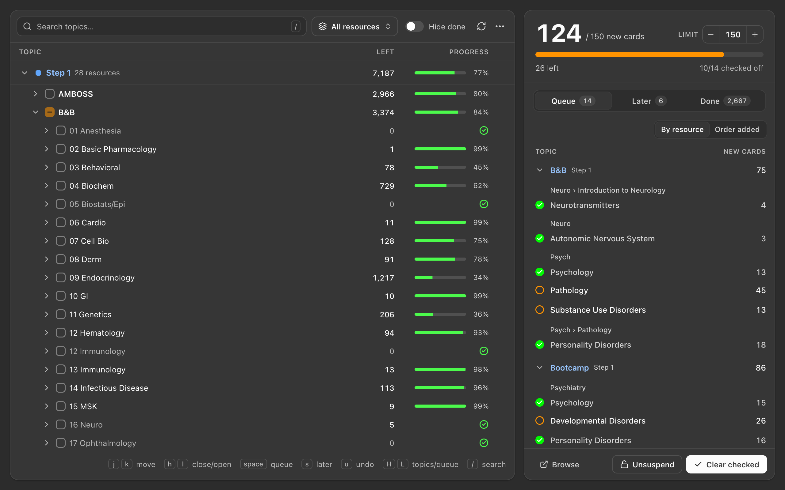

# Stepwise

**Unsuspend your deck one topic at a time, within a daily new-card limit.**
(Formerly Tag Queue.)


An [Anki](https://apps.ankiweb.net/) add-on for planning study sessions by tag.
Tick the topics you'll cover today, grouped by resource (B&B, Bootcamp,
Pixorize, Sketchy, …). A live meter shows how many **new cards** that adds
against your session limit. When you've covered a topic (a video, a chapter,
a set of notes), check it off, which also unsuspends its cards.

It's built for the AnKing workflow of "cover the resource, unsuspend its cards",
and works with any hierarchical tags. The window is a web UI (React) that follows
Anki's light and dark themes, with vim-style keyboard navigation.



## Features

- **Tag tree by resource, split by step.** Resources sit under colour-coded
  **Step 1 / Step 2 / Step 3** sections that stay pinned to the top while you
  scroll, and the resource you're scrolling through stays pinned just under its
  step, so you can always tell which one a topic belongs to. Checkboxes queue
  topics. Each topic shows how many cards are
  **Left** to unsuspend and a **Progress** bar of its cards (hover it for the
  numbers); Later topics get a bookmark there instead and done ones a check
  (hover for the date). Queue, Later and Done rows carry a matching step chip.
- **Keyword search.** Type `brainstem` or `b&b cardio` to see matching topics
  from every resource, nested under the resource they belong to. Every word
  has to turn up somewhere in a topic's path, but loosely: part of a word
  (`cardio` finds Cardiology), another ending (`developmental` finds
  Development), a typo (`pyschiatry`), or a common abbreviation (`msk`, `peds`,
  `heme`, `gi`). Words like "and" and "of" are skipped. With **Hide done** on,
  finished topics are left out of the results too. A dropdown next
  to the search box limits the tree and the search to **all resources**, your
  **pinned resources**, or a **single resource**.
- **Queue all matches.** One click queues every topic the search found that
  isn't already queued or completed. Hover the button to see how many new
  cards that adds; it asks first if the total would go over your limit.
- **Save for later.** Found a topic that won't fit this session? Hover it and
  click the bookmark (or press **s**) to park it in the **Later** tab, where it
  doesn't count toward your limit. Going over the limit offers **Move to
  Later** right in the warning, and **Fill queue** later queues the oldest
  Later topics that fit under your limit.
- **One number, one bar.** **Left** is what you still have to unsuspend. The
  bar fills with the cards you've studied, then, in a lighter green, the ones
  **waiting**: already unsuspended but not studied yet, including any buried
  by sibling settings, which come back by themselves. The percentage is the
  unsuspended share, so waiting cards count: there's nothing left to do for
  them. The bar's tooltip has the exact numbers, the total, and how many of
  the topic's subtopics are done.
- **Grouped by resource.** Queue and Later group topics under their resource
  (Pixorize, Bootcamp, …) with each group's unique new-card count in the same
  column as the topics' counts (labelled once, at the top), and each topic
  sits under a heading for its folder. Hover a row or a resource for its
  buttons; a resource's check off all its topics or move them to or from
  Later. Switch to "Order added" any time.
- **Done takes care of itself.** A topic whose every card has been studied
  counts as done and leaves Queue/Later on its own (cards that are only
  unsuspended keep it open). Topics you studied without ever queuing or
  colouring them are marked done too, dated the day you finished them:
  in every resource you use, down to the deepest level you've queued at
  there (so stray question IDs and sub-headings that other resources' cards
  happen to finish don't bury the Done list). Once everything in a folder is done the folder
  itself is marked complete, so Done shows "16 Neuro" rather than each of its
  videos.
- **Click to find it.** Click any row in Queue, Later or Done to jump to that
  tag in the tree: it opens the step, resource and folders, scrolls there and
  highlights it.
- **Unique-card meter.** The queue counts each card once, even when it's tagged
  under several queued topics (common in AnKing, where one card carries B&B,
  Bootcamp and Pixorize tags). Select a topic to see how many cards it *would
  add* before you queue it.
- **Daily plan.** The queue is your plan for the day's new cards (150 by
  default). The meter counts the new cards in it that Anki will show you
  today, still suspended or already unsuspended, so checking a topic off
  doesn't change it; studying the cards does. It turns red when the plan
  goes over.
- **Follows sibling burying.** With **Bury new siblings** on in a deck's
  options (AnKing's preset has it on), Anki shows one new card per note a
  day, so a note with three clozes counts as one today. Buried cards, and
  notes with a sibling due for review today, wait for a later day. A queue
  row's tooltip says how many more come after today.
- **Check off as you go.** Clicking the ring beside a queued topic unsuspends
  its cards and checks it off. It stays in the queue (click the check to take
  that back) until every card in it is studied, then moves to Done by itself.
  Anything unfinished carries over to the next day. **Clear checked** takes
  checked-off topics off early.
- **Deck-screen meter.** A compact meter under the deck list; click it to open
  the queue.
- **See a topic's cards in Skim.** With
  [Skim](https://github.com/AIbrahimv2/AnkiSkim) installed (a fast card
  browser with vim keys), `b` on a topic shows its cards there instead of in
  Anki's browser (`Shift+B` still opens Anki's browser). Leave
  Skim open and it follows you: every topic you move to shows its cards,
  while the keys stay in Stepwise. `p` in Skim comes back.
- **Browser sidebar.** Right-click any tag (or several) → **Stepwise** → Add to
  queue / Mark completed.
- **Colorful Tags integration.** If
  [Colorful Tags](https://ankiweb.net/shared/info/594329229) is installed,
  queued tags turn orange and completed tags green in the Browser sidebar
  automatically. If you already colour tags by hand, the first run offers to
  import those colours as queued or completed.
- The queue is saved in your collection, so it's per profile and syncs with it.

## Usage

1. Open **Tools → Stepwise** (Cmd/Ctrl+Shift+S) or click the meter on the deck
   screen.
2. Expand a resource and tick the topics you plan to cover. Ticking a parent
   queues everything under it. Or search for a keyword, pick the resource you're
   using from the dropdown, and click **Queue N** to queue every match. Keep
   the meter under your limit.
3. Work through the topics one by one (watch the video, read the chapter) and
   click the ring beside each one when you're done. Its cards are unsuspended and it's checked off, but it stays in the plan, so the meter
   keeps showing the day's new cards.
4. Study. As you finish a topic's cards it leaves the queue by itself; whatever
   you didn't get to stays queued for tomorrow, still counted against the
   limit.

Hit your limit but found more to do? Press **s** on a topic (or click its
bookmark) to save it for later. Next session, open the **Later** tab and click
**Fill queue**.

Right-click a topic for more: save it for later, browse its cards (in Skim
or Anki's browser), unsuspend without completing, clear its status, or pin a
resource to the top.

In a narrow window (under 760px) the topics and the queue take turns: switch
between them at the top of the window. The tree's bars get shorter before it
squeezes topic names.

### Keyboard

The tree remembers which folders you had open (and which step sections you
closed), even after restarting Anki. It uses vim keys (arrow keys, Home and End work too). They work as
soon as the window opens, and from anywhere on the page except text fields:

| Keys | Does |
| --- | --- |
| `j` / `k` | Move down / up |
| `10j` / `8k` | Type a number first to move that many rows (arrow keys too) |
| `10G` or `10gg` | Go to row 10 |
| `l` / `h` | Open a folder or step into it / close it or go to its parent |
| `gg` / `G` | Jump to the top / bottom |
| `Ctrl-d` / `Ctrl-u` | Move half a page down / up |
| `5` then `Ctrl-d` or `Ctrl-u` | Move 5 rows, and keep moving 5 until you reopen the window |
| `o` or `Enter` | Open or close a folder |
| `Space` | Queue or unqueue the topic |
| `s` | Save the topic for later (or take it back off Later) |
| `b` | See the topic's cards: in Skim if it's installed (it follows as you move), otherwise in Anki's browser |
| `Shift+B` | See them in Anki's browser, even with Skim installed |
| `p` | The same as `b` with Skim installed |
| `u` or `Cmd/Ctrl+Z` | Undo the last change |
| `Ctrl-r` or `Cmd/Ctrl+Shift+Z` | Redo it |
| `/` | Search |
| `Enter` / `Shift+Enter` (in search) | Go to the next / previous match and on to the tree, where `n` / `N` carry on |
| `n` / `N` | Next / previous search match (`3n` goes three matches on) |
| `Esc` | Cancel a number you've typed; leave the search box (results stay); again to clear the search |
| `Shift+L` / `Shift+H` | Move to the queue panel / back to the topics (in a narrow window, switch which one shows) |

The queue panel has vim keys too, once `Shift+L` (or a click on the list)
gives it the keys. They act on the row under the cursor, in whichever tab
shows:

| Keys | Does |
| --- | --- |
| `j` / `k`, `gg` / `G`, `Ctrl-d` / `Ctrl-u` | Move, as in the tree, numbers included (`5j`, `3G`) |
| `h` / `l` | Go to the topic's resource, close it / open it, or step into it |
| `Space` | Check the topic off, or uncheck it (in Later and Done, move it to the queue) |
| `s` | Move it to Later (in Later, take it off) |
| `x` or `dd` | Remove it from the queue (in Later, take it off; in Done, clear it) |
| `Enter` or `o` | Show the topic in the tree; on a resource, close or open it |
| `b` | The topic's cards, in Skim if it's installed, otherwise in Anki's browser (on a resource, all its topics); Skim follows the cursor here too |
| `Shift+B` | The same in Anki's browser, even with Skim installed |
| `p` | The same as `b` with Skim installed |
| `gt` / `gT` | Next / previous tab (`2gt` goes to Later) |

Press `?` anywhere in the window (or **⋯ → Keys**) to see all of these.

On a resource, `Space` and `s` act on all of its topics, like its buttons.
Checked-off topics keep their place until you uncheck them or **Clear
checked**, so `s` and `x` leave them alone.

Undo covers what you do in the Stepwise window (queue, unqueue, Later,
check off, clear, Fill queue, queue or save all search matches, imports),
up to 50 steps back. Undoing a check-off puts the topic back in the queue
and suspends the cards it unsuspended again, if you haven't studied them
yet. Changes made elsewhere since (the Browser sidebar, automatic Done)
are left alone.

### Settings

**⋯ → Settings…** in the Stepwise window (Anki's **Config** button for the
add-on opens the same thing) covers the daily limit and what counts toward
it, unsuspending on check-off, which top-level tags hold your resources
(with a live list of what each pattern matches), pinned resources, the
deck-screen meter, the keyboard shortcut (press the keys to record it), and
the queued/done/later colours used here and in the Browser sidebar. Changes
apply when you save; there's no JSON to edit.

## Installation

### From AnkiWeb

In Anki, open **Tools → Add-ons → Get Add-ons** and paste the code
`1949793886`. It needs Anki 26.09.4 or newer. See the
[AnkiWeb page](https://ankiweb.net/shared/info/1949793886).

### Manual

Download `stepwise.ankiaddon` from the
[Releases](https://github.com/AIbrahimv2/AnkiStepwise/releases) page and
double-click it, or run `./build.sh` and open the file it writes to `dist/`.

## Development

The add-on that Anki loads lives entirely in `src/`. To test changes live,
symlink `src/` into your Anki add-ons folder and restart Anki:

```bash
ln -s "$(pwd)/src" ~/Library/Application\ Support/Anki2/addons21/anki-tag-queue
```

The window's UI is a React + TypeScript app in `web/`, built with Vite into
`src/web/app.js` and `src/web/app.css` (committed, so the add-on works straight
from a checkout). It talks to Python through Anki's `pycmd` bridge:
`src/bridge.py` handles the commands, and `src/viewmodel.py` shapes the data.

```bash
cd web && npm install
npm run build        # rebuild src/web/ after changing the UI
```

To work on the UI with live reload and **real data**, run the dev server. It
uses Anki's own Python to serve the real bridge against a temporary copy of a
collection, then start Vite:

```bash
PY=~/Library/Application\ Support/AnkiProgramFiles/python/cpython-3.13.5-macos-aarch64-none/bin/python3
"$PY" tools/devserver.py --collection ~/Library/Application\ Support/Anki2/User\ 1/collection.anki2
cd web && npm run dev   # http://localhost:5173 (add ?theme=dark for dark mode)
```

Run `./build.sh` to build the UI and produce a distributable `.ankiaddon` in
`dist/`.

The tests in `tests/` run with Anki's own Python against a snapshot of a real
collection (an AnKing deck, with Colorful Tags installed). The snapshot stays
in `tests/fixture/`, which git ignores, so your cards don't end up in the repo:

```bash
python3 tests/make_fixture.py   # once, or again to test against newer data
./tests/run.sh                  # all of them, or name some: ./tests/run.sh test_bridge
```

## License

[AGPL-3.0-or-later](LICENSE).
