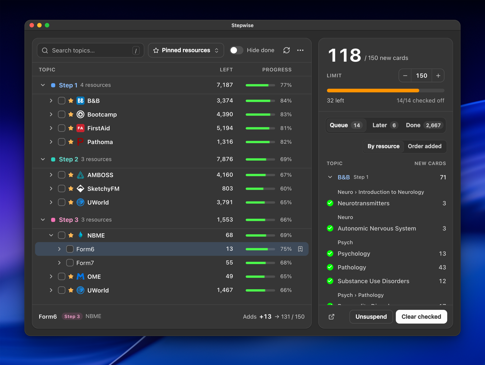

# AnkiWeb listing

What's in the AnkiWeb add-on form (https://ankiweb.net/shared/upload?id=1949793886).

How AnkiWeb's add-on search behaves, tested in November 2026:

- It looks for the exact phrase, in order, in the title, description and tags.
  Partial words match too ("study plan" finds "study planner"), but "unsuspend
  anking" doesn't find "unsuspend relevant AnKing cards". So the wording people
  would type needs to appear literally.
- Tags don't show on the page, but they're searched as one line, so neighbouring
  tags work as a phrase. Their order matters.
- Words only decide whether an add-on appears. Results are ordered by ratings,
  and nothing here changes that.
- The screenshot is the README's (docs/screenshot.png), linked from GitHub, so
  replacing that file updates both.
- Wrap an image in `<p>`: on its own, AnkiWeb leaves it inline, so the list
  after it starts with no gap.

## Package on AnkiWeb

Version 1.4.0, uploaded 2026-11-17. The release script (`release.py --uploaded`
in the `anki-addon-release` skill) updates this line after each upload.

## Supported Anki versions

Minimum 24.04, maximum 26.09.4 with no `-`, so newer versions get it too. The
form turns 24.04 into "24.04.0", and the listing shows "24.04-26.09.4+".

Anki says the code is invalid to anyone below the minimum. Until
2026-11-14 the minimum was 26.09.4, the version installed when 1.1.1 was
released, and the first review was "Anki says code is invalid".

Why 24.04:

- It's the first release whose Mac, Windows and Linux builds all ship Qt 6.6,
  whose web view is Chromium 112. The stylesheet uses `color-mix()`, which
  needs Chromium 111, so on the Qt 6.5 builds (2.1.66, and 23.12 on Mac) most
  colours would be missing. The web build targets Chrome 112 to match.
- Up to 25.02, Anki runs add-ons on Python 3.9. Stepwise works there.

Tested on 2026-11-14 with `tests/run_on_anki.sh`. All 21 tests pass on 24.04,
24.06.3, 24.11 and 25.02.7 (Python 3.9, Qt 6.6), 25.07.5 and 25.09.4 (Python
3.13, the launcher's default Qt), and 26.09.4 (the installed app). The 1.1.1
code, which is what AnkiWeb serves, passes its 19 tests on 24.04 and 25.07.5.
Not tested: the launcher's optional Qt
6.7 and 6.8 builds (`QT=qt67`, `QT=qt68`), which sit between versions that
pass.

## Title

🪜 Stepwise: unsuspend AnKing one topic at a time

## Tags

anking unsuspend cards study planner usmle comlex step1 medical school checklist queue tags planning

## Description

Paste as is. AnkiWeb takes Markdown and basic HTML. It follows the layout in
the `anki-addon-release` skill's listing conventions: what it does, the code
line and the screenshot first, the signature last.

```markdown
A study planner for AnKing and other medical school decks. Tick the topics you're covering today (a Boards and Beyond video, a Pixorize set, a First Aid chapter) and Stepwise shows how many new cards that adds against your daily new card limit. When you've covered a topic, check it off and its cards are unsuspended.

**Code: 1949793886.** Paste it in Anki under **Tools → Add-ons → Get Add-ons**.

<p></p>

Unsuspend by tag without opening the Browser. Built for the AnKing Step 1 / Step 2 / Step 3 decks for USMLE and COMLEX, and works with any deck that uses hierarchical tags.

**Features**

- Tag tree by resource: B&B, Bootcamp, Pixorize, Sketchy, Pathoma, First Aid, Physeo, Osmosis, OME, Ninja Nerd, Dirty Medicine, AMBOSS, UWorld, NBME and the rest, showing the cards left to unsuspend and a progress bar per topic.
- A meter of today's new cards. It follows Bury new siblings, so a note with three clozes counts once, the way Anki will show it.
- Search across every resource, then queue all matches in one click.
- Save topics for later when they don't fit today; fill the queue from them next time, oldest first.
- Topics move to Done by themselves once every card in them is studied.
- Undo, vim-style keys, light and dark mode, a meter on the deck screen.
- Works with Colorful Tags: queued topics turn orange and done ones green in the Browser sidebar, and your existing colours can be imported.

Open it from Tools → Stepwise (Cmd/Ctrl+Shift+S). Your queue is saved in your collection, so it syncs with it.

Source, changelog and issues: [github.com/AIbrahimv2/AnkiStepwise](https://github.com/AIbrahimv2/AnkiStepwise)

<p><a href="https://abdelrahmanibrahim.com/anki/"></a></p>
```
